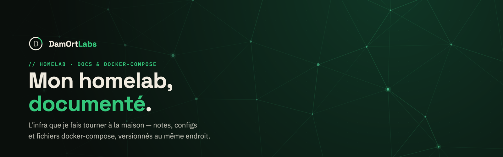
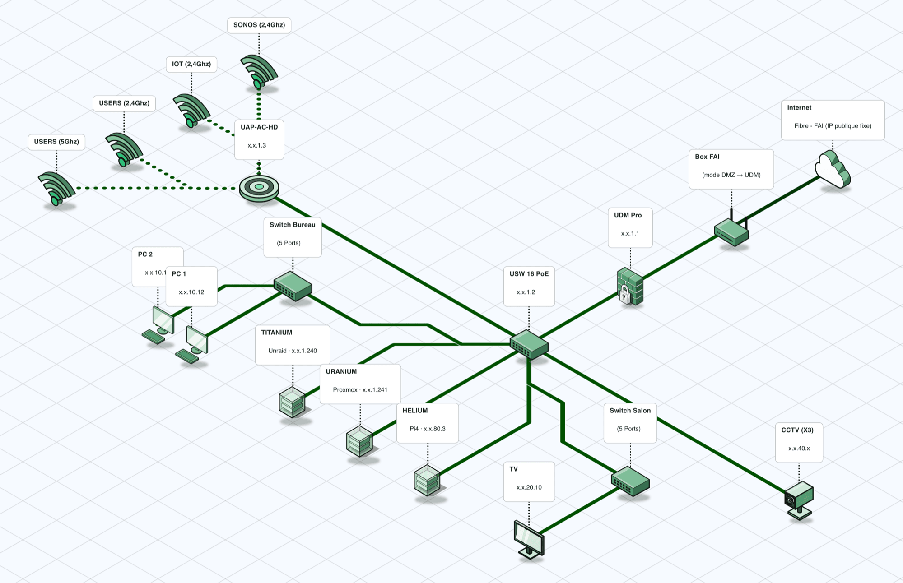

> Mon labo auto-hébergé : un réseau segmenté, trois machines pour la virtualisation, une vingtaine de services en conteneurs, des sauvegardes 3-2-1 chiffrées et de la supervision.
>
> Je le documente surtout pour **m'y retrouver moi-même** — de tête, ça ne tient pas. Et je le partage au cas où ça dépanne quelqu'un.

> [!IMPORTANT]
> Version **publique expurgée** : IP publique, adresses MAC, nom de domaine et éléments sensibles (caméras, secrets) ont été retirés ou rendus génériques.

 

---

## 🗺️ Vue d'ensemble

Trois hôtes, un réseau segmenté en VLANs derrière un pare-feu *zone-based*, une vingtaine de services auto-hébergés, le tout sauvegardé et supervisé.

*Topologie physique — du lien fibre aux postes, serveurs et caméras (vue isométrique). Le détail logique est en [Mermaid](schemas.md).*

 

| Brique | Détail |
|---|---|
| **Hôtes** | `titanium` (Unraid — NAS + Docker + VM) · `uranium` (Proxmox — VM/LXC) · `helium` (Raspberry Pi 4 — supervision) |
| **Réseau** | Box FAI → UDM Pro (UniFi) · une dizaine de VLANs actifs · pare-feu *zone-based* (8 zones) |
| **Sécurité** | DNS filtrant (AdGuard + unbound) · reverse proxy en DMZ (Zoraxy) + certificats wildcard Let's Encrypt · **IDS/IPS (UDM Pro)** · **CrowdSec** · WireGuard · Cloudflare Tunnel · pare-feu **audité ~89/100** ([méthode](security.md#audit-du-pare-feu)) |
| **Services** | Vaultwarden, Home Assistant, Jellyfin, WordPress, PeerTube, n8n, GLPI, AdGuard… |
| **Sauvegarde** | 3-2-1 : parité Unraid + appdata en local · offsite chiffré (restic → cloud souverain UE) · restauration testée |
| **Supervision** | Prometheus + Grafana + Loki · Uptime Kuma + alerting |

→ Schémas (topologie · segmentation · flux d'accès · sauvegarde) : **[schemas.md](schemas.md)**

---

## 🧰 Stack

- **Hyperviseurs / OS** : Proxmox VE · Unraid · Debian · Raspberry Pi OS
- **Conteneurs** : Docker · LXC
- **Réseau** : UniFi (UDM Pro) · VLAN 802.1Q · pare-feu *zone-based* · WireGuard
- **Sécurité** : AdGuard + unbound · UniFi IDS/IPS · CrowdSec · Zoraxy · Let's Encrypt · Cloudflare · Vaultwarden · YubiKey (FIDO2)
- **Sauvegarde** : restic · vzdump · stratégie 3-2-1
- **Observabilité** : Prometheus · Grafana · Loki · Uptime Kuma

---

## 📚 Documentation

- **[Matériel](hardware.md)** — les 3 hôtes (CPU, RAM, stockage), le réseau, la baie
- **[VLANs & segmentation](vlans.md)** — plan d'adressage, zones de confiance, principes de segmentation
- **[Réseau](network.md)** — WAN, DNS filtrant forcé, certificats, accès distant
- **[Sécurité](security.md)** — pare-feu zone-based, audit, IDS/IPS, durcissement des accès, modèle de menace
- **[Sauvegarde](backup.md)** — 3-2-1, offsite chiffré, procédure de restauration testée
- **[Services](services.md)** — les services auto-hébergés, par catégorie
- **[Supervision](supervision.md)** — Prometheus/Grafana/Loki, Uptime Kuma, alerting
- **[Compose](compose/README.md)** — stacks Docker expurgées (monitoring, médiathèque)
- **[Schémas](schemas.md)** — diagrammes Mermaid

---

## 💡 Pourquoi ces choix

Ce lab est mon terrain d'apprentissage, et j'ai une règle : comprendre *pourquoi* je fais un choix plutôt que d'appliquer une recette. Quelques exemples :

- **Pare-feu par zones** plutôt que des règles à plat : avec des règles en vrac, je finissais par ne plus m'y retrouver. Par zones, je relis ma conf sans me prendre la tête.
- **Sauvegarde hors-site chez un hébergeur européen** plutôt qu'un géant américain — je préfère savoir où vivent mes données. Et comme restic chiffre côté client, le prestataire ne voit que des blocs illisibles de toute façon.
- **Tester les restaurations, pas seulement les configurer.** Je me suis fait avoir une fois : des sauvegardes qui plantaient en silence depuis plusieurs jours, tombées par hasard sous mes yeux. Depuis, j'en restaure pour de vrai de temps en temps, et une alerte me prévient si ça échoue.
- **Le monitoring sur une machine à part** (un petit Pi), pas sur les serveurs qu'il surveille : sinon il tombe en même temps qu'eux et ne sert plus à rien.
- **Exposer le moins possible** : un seul point d'entrée public (le reverse proxy), et en interne les mêmes URLs qui résolvent en direct (split-DNS).

---

*Un labo perso, bien réel, que je fais tourner et que je documente au fil de l'eau — d'abord pour m'y retrouver moi-même.*
