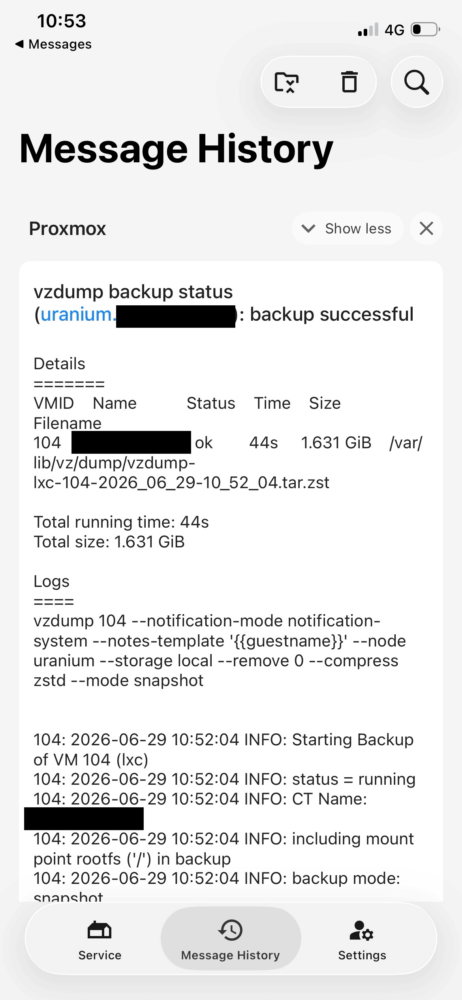

# 💾 Sauvegarde & restauration

Stratégie **3-2-1** : 3 copies, 2 supports, 1 hors-site chiffré. Principe directeur : « un backup jamais restauré n'existe pas ».

## Le 3-2-1 en pratique

| | Quoi | Où |
|---|---|---|
| **Copie locale** | données + configs des services | NAS (Unraid), array protégé par parité |
| **2ᵉ support** | sauvegardes appdata / VM / config | jeu de sauvegardes séparé sur le NAS |
| **Hors-site** | l'irremplaçable, chiffré | cloud souverain (UE) via restic |

La copie hors-site part chez un hébergeur européen via restic, qui chiffre côté client (AES-256) : le prestataire ne voit que des blocs illisibles. La déduplication et le versionnement donnent un historique profond pour peu de volume.

## Sauvegarde des VM / conteneurs (Proxmox)

- **vzdump** (snapshot + `fsfreeze`, cohérent même pour les bases SQLite), stocké en NFS sur le NAS, puis repris automatiquement dans le push hors-site.
- Rétention échelonnée (quotidienne / hebdomadaire / mensuelle).

## Restauration

Un backup ne « compte » que s'il se restaure :
- Restauration d'un conteneur critique dans un environnement jetable, vérification que les données et les clés sont intactes, puis destruction.
- Contrôle que la donnée hors-site est bien présente et déchiffrable.

## Fiabilisation & supervision

En vérifiant la chaîne, je me suis aperçu qu'une sauvegarde échouait depuis plusieurs jours sans alerte : un montage réseau tombé en « stale ». Deux correctifs en ont découlé, la bascule du montage CIFS → NFS (reconnexion automatique après coupure) et une alerte sur échec, en push sur le téléphone via le serveur de notification auto-hébergé. Depuis, un échec déclenche une notification au lieu de passer inaperçu dans un log.

*Chaque sauvegarde Proxmox notifie sur le téléphone, succès comme échec, via le serveur de notification auto-hébergé.*

---

Supervision et alerting : [services.md](services.md).
