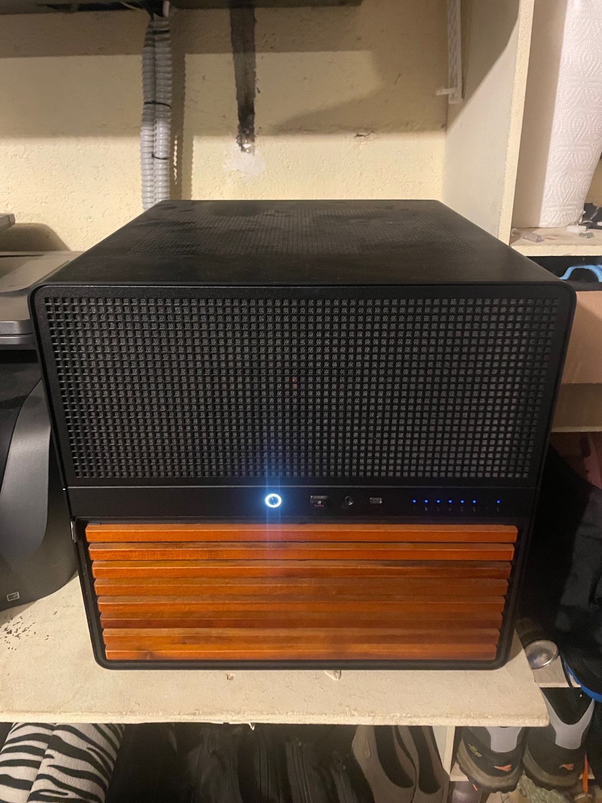
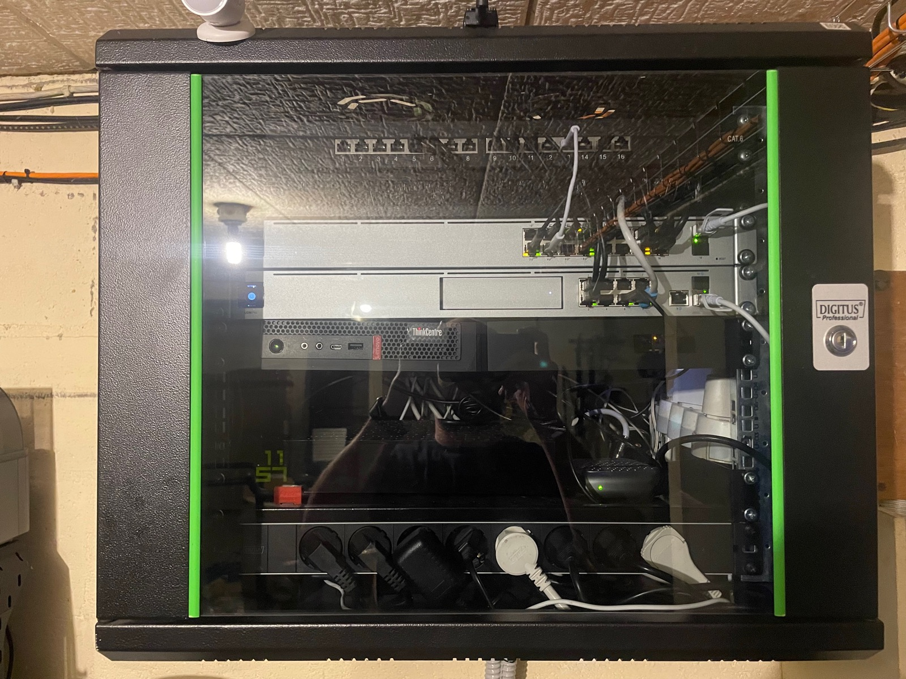
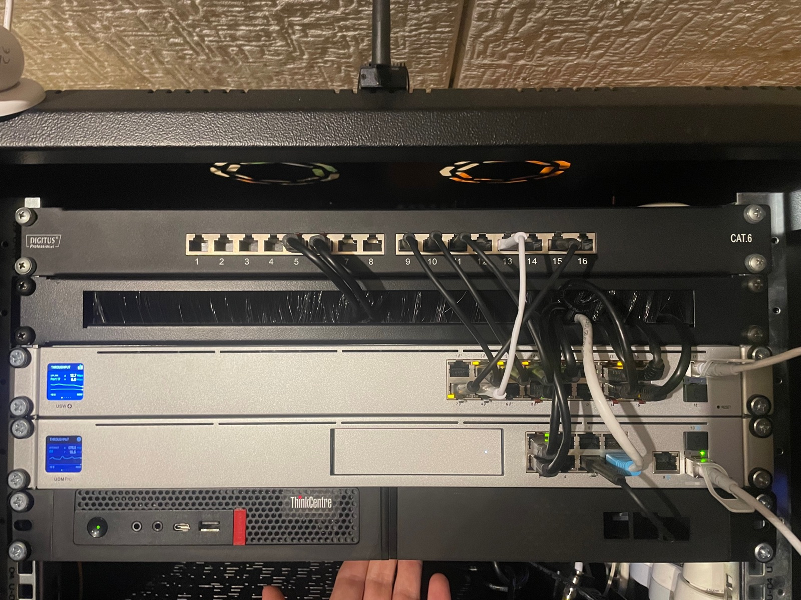
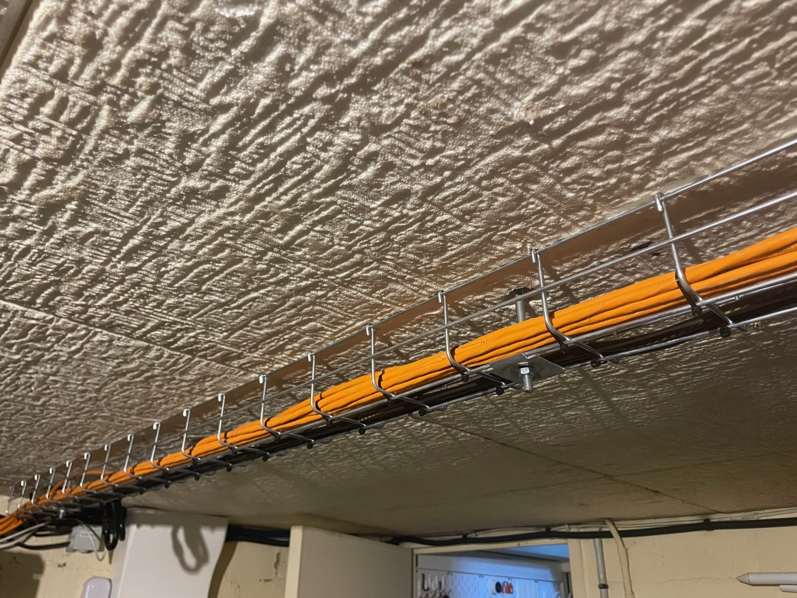

# 🖥️ Matériel

Trois machines auto-hébergées, choisies pour être silencieuses et sobres en électricité : du matériel grand public ou reconditionné, pas de gros serveur rack bruyant.

## Serveurs

### `titanium` : NAS & conteneurs
| | |
|---|---|
| **Rôle** | Stockage (NAS), conteneurs Docker, VM Home Assistant |
| **OS** | Unraid |
| **Carte mère** | ASUS ROG STRIX Z370-I GAMING (Mini-ITX) |
| **CPU** | Intel Core i3-8350K (4 c / 4 t @ 4,0 GHz) |
| **RAM** | 32 Go DDR4 (2× 16 Go @ 2747 MT/s) |
| **Boot** | Clé USB SanDisk Cruzer Fit 64 Go |
| **Disques durs** | 3× Seagate IronWolf 12 To, 3× WD Red 6 To, 1× WD Red 3 To |
| **SSD / NVMe** | 1× Samsung 850 PRO 512 Go (SATA), 2× Crucial P3 1 To (NVMe) |

> **Organisation Unraid** : array protégé par parité (1 disque de parité + disques data) + pool cache NVMe (appdata, conteneurs). Le disque WD Red 3 To est en cours de retrait (erreurs SMART détectées, remplacement propre via *New Config* + reconstruction de parité).

### `uranium` : virtualisation
| | |
|---|---|
| **Rôle** | Hyperviseur (VM & conteneurs LXC) |
| **OS** | Proxmox VE |
| **Modèle** | Lenovo ThinkCentre (mini-PC) |
| **CPU** | Intel Core i5-8500T (6 c / 6 t @ 2,1 GHz, 35 W, basse conso) |
| **RAM** | 32 Go DDR4 (2× 16 Go @ 2667 MT/s) |
| **Stockage** | 1× NVMe 512 Go (Samsung) : système + stockage LVM-thin |

### `helium` : supervision
| | |
|---|---|
| **Rôle** | Stack de supervision, séparée des hôtes qu'elle observe (voir [supervision.md](supervision.md)) |
| **OS** | Raspberry Pi OS |
| **Modèle** | Raspberry Pi 4 Model B (Rev 1.4) |
| **CPU** | Broadcom BCM2711 (ARM Cortex-A72, 4 c) |
| **RAM** | 8 Go |
| **Stockage** | SSD NVMe M.2 128 Go *(boot sur NVMe via HAT, pas de carte SD)* |

## Réseau

| Élément | Modèle | Rôle |
|---|---|---|
| **Passerelle / pare-feu** | UniFi Dream Machine Pro (UDM Pro) | routage inter-VLAN, pare-feu zone-based, contrôleur UniFi |
| **Switch** | UniFi Switch 16 PoE (USW-16-PoE) | distribution, trunks VLAN, PoE (AP + caméras) |
| **Point d'accès** | UniFi UAP-AC-HD | WLANs segmentés (users, IoT, invité…) |
| **Caméras** | 3× caméras IP | vidéosurveillance (VLAN CCTV isolé) |

> **Évolution prévue** : un 2ᵉ point d'accès pour étendre la couverture WiFi (RJ45 déjà tiré et patché, en attente).

## Baie & câblage

Câblage structuré maison : RJ45 par pièce, patchés en baie *(héritage de 18 ans en télécom / courant faible)*.

> **Astuce maison** : le mini-PC `uranium` (ThinkCentre, non rackable d'origine) est monté en baie via un support 19″ imprimé en 3D.

| Élément | Détail |
|---|---|
| **Baie** | Armoire murale 19", 9U |
| **Brassage** | Panneau Cat-6 blindé, 16 ports RJ45 (1U) |
| **Alimentation** | PDU rackable 19", 8 prises, 16 A (1U) |
| **Étagère** | Étagère fixe 19" 1U (prof. 250 mm) |

*La baie : panneau de brassage Cat-6, switch UniFi, hyperviseur (ThinkCentre) et PDU, dans une armoire murale 9U.*

*Détail : patch panel Cat-6 16 ports et équipements UniFi (passerelle + switch).*

*Câblage structuré : dorsale Cat-6 routée sur chemin de câbles, desservant chaque pièce.*

Le plan d'adressage et les zones sont détaillés dans [vlans.md](vlans.md).
