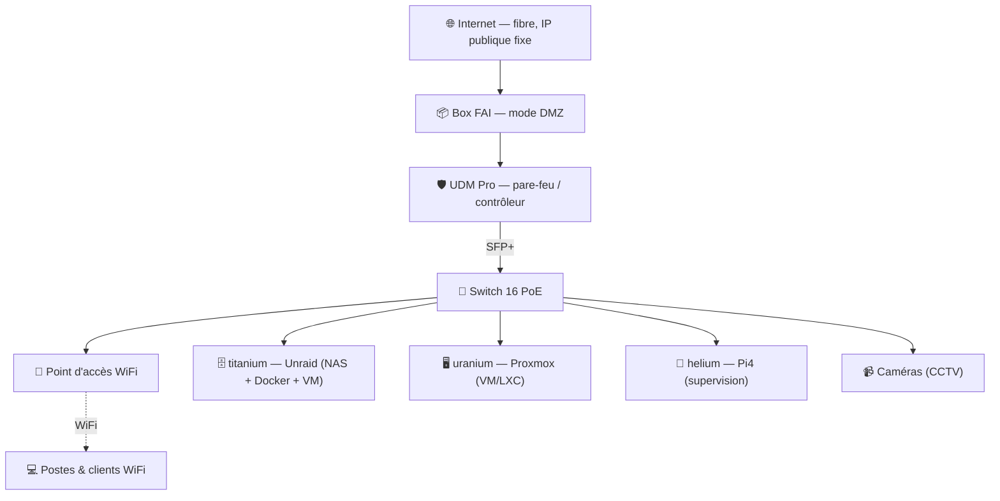
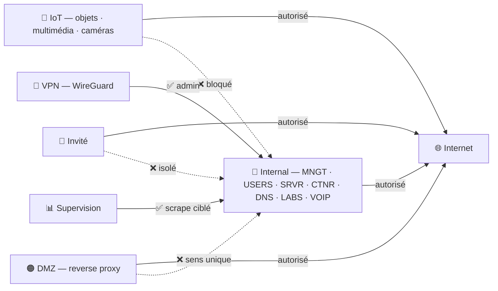
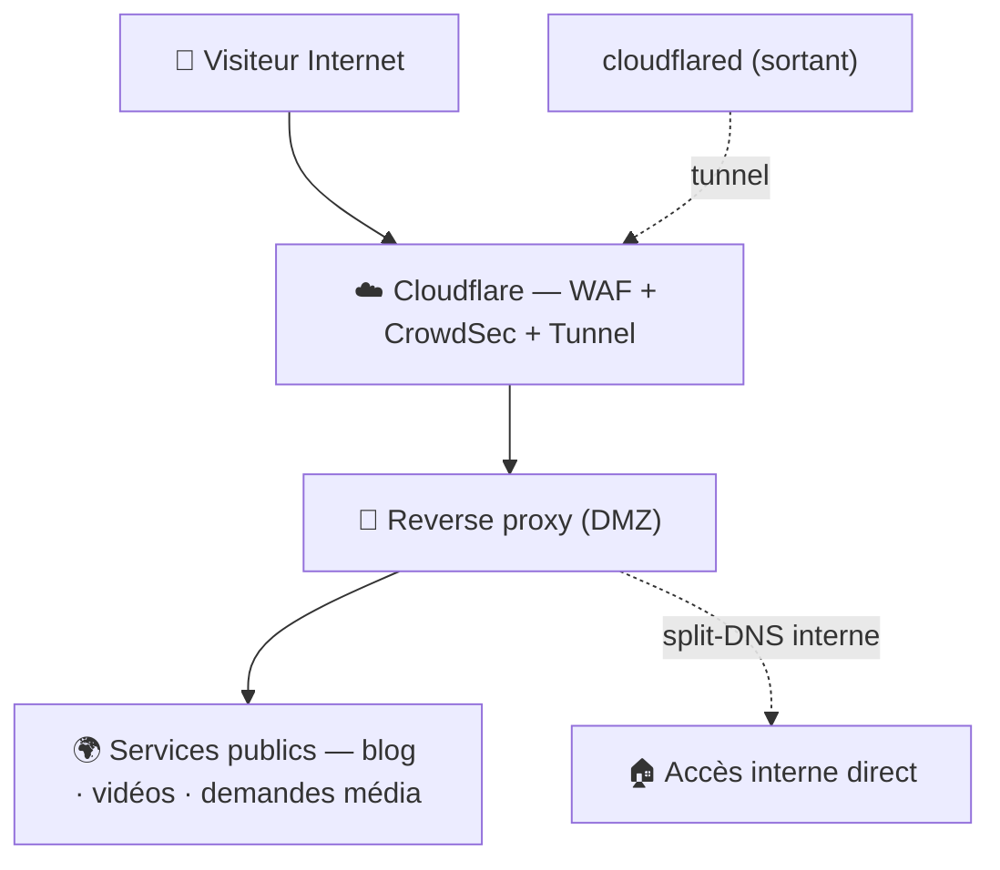
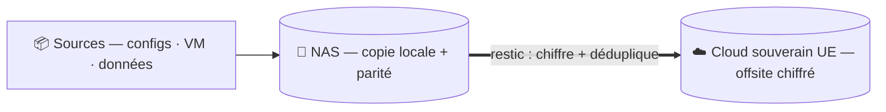

# 🗺️ Schémas

Diagrammes **Mermaid** (rendu natif sur GitHub) — la vue **logique** de l'infra. Des versions **isométriques** (FossFLOW) illustrent les pages dédiées.

## 1. Topologie physique

## 2. Segmentation (zones de confiance)

## 3. Flux d'accès (exposition Internet)

## 4. Sauvegarde (3-2-1)

---

*Détails : [réseau](network.md) · [segmentation VLAN](vlans.md) · [sauvegarde](backup.md).*
