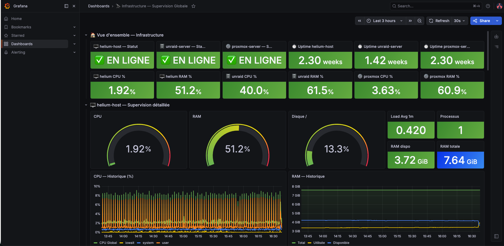
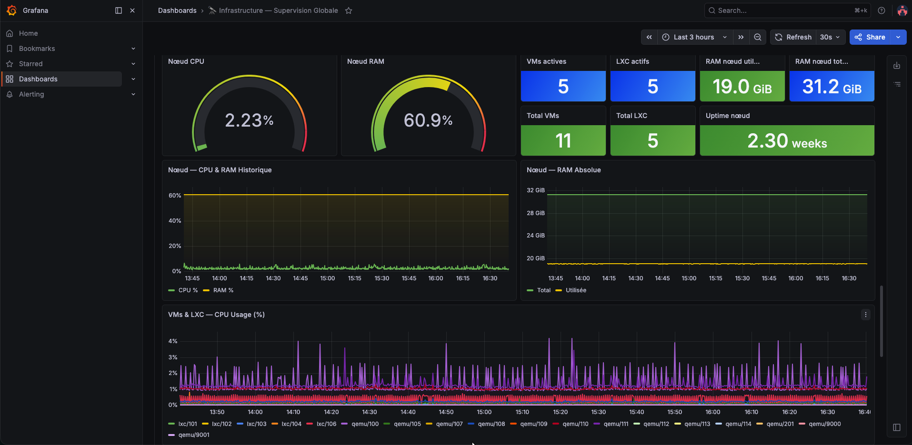
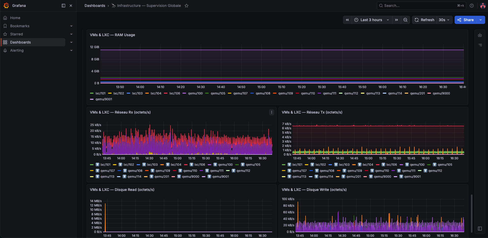

# 📊 Supervision & observabilité

La supervision tourne sur helium (Raspberry Pi 4), volontairement hors des hôtes qu'elle surveille : un monitoring hébergé sur la machine qu'il observe tombe en même temps qu'elle. Le Pi reste un point d'observation indépendant.

## Stack

| Outil | Rôle |
|---|---|
| **Prometheus** | collecte des métriques (hôtes, réseau, VM/LXC) |
| **Grafana** | tableaux de bord |
| **Loki** | centralisation des logs |
| **Uptime Kuma** | disponibilité des services + alerte sur échec |

## Ce qui est suivi

Grafana suit la santé des trois hôtes (statut, uptime, CPU, RAM), les débits réseau par VLAN et le détail de chaque VM/LXC (RAM, réseau, disque). Uptime Kuma sonde la disponibilité de bout en bout : DNS, domaine, Internet, réseau, serveurs, conteneurs. La liste complète des services suivis est dans [services.md](services.md).

## Alerting

Uptime Kuma notifie chaque échec par push sur le téléphone, via un serveur de notification auto-hébergé, avec repli SMS. Une alerte dédiée aux échecs de sauvegarde complète le dispositif (voir [backup.md](backup.md)).

## En images

Santé des 3 hôtes d'un coup d'œil (statut, uptime, CPU, RAM) :

Trafic réseau par VLAN et virtualisation par VM/LXC :

Disponibilité et alerte sur échec (Uptime Kuma) :

## Déploiement

La stack est décrite en Docker Compose, configurations Prometheus / Loki / Promtail incluses, secrets externalisés dans un `.env` (gitignoré) :

**[`compose/monitoring/`](compose/monitoring/)**
