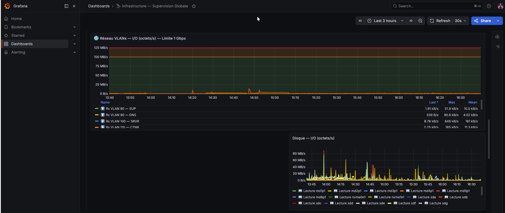
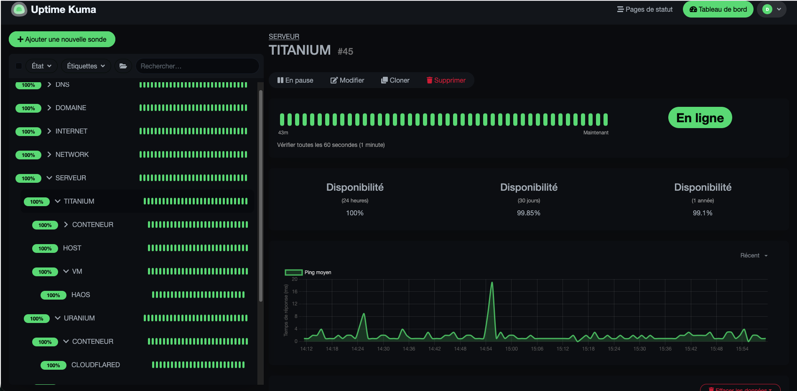

# 📊 Supervision & observabilité

La supervision tourne sur **helium** (Raspberry Pi 4), **volontairement hors des hôtes qu'elle surveille** : un monitoring hébergé sur la machine qu'il observe tombe en même temps qu'elle. Le Pi reste un point d'observation indépendant.

## Stack

| Outil | Rôle |
|---|---|
| **Prometheus** | collecte des métriques (hôtes, réseau, VM/LXC) |
| **Grafana** | tableaux de bord |
| **Loki** | centralisation des logs |
| **Uptime Kuma** | disponibilité des services + alerte sur échec |

## Ce qui est suivi

- **Santé des 3 hôtes** : statut, uptime, CPU, RAM.
- **Réseau par VLAN** : débits entrée / sortie.
- **Virtualisation par VM/LXC** : RAM, réseau, disque.
- **Disponibilité des services** : sondes Uptime Kuma (DNS · domaine · Internet · réseau · serveurs → conteneurs).

## Alerting

- **Uptime Kuma** notifie sur **échec** : push sur le téléphone via un serveur de notification auto-hébergé, repli SMS.
- Une **alerte sur échec de sauvegarde** complète le dispositif → [backup.md](backup.md).

## En images

Santé des 3 hôtes d'un coup d'œil (statut, uptime, CPU, RAM) :

Trafic réseau **par VLAN** et virtualisation **par VM/LXC** :

Disponibilité et alerte sur échec (Uptime Kuma) :

## Déploiement

La stack est décrite en **Docker Compose** — configurations Prometheus / Loki / Promtail incluses, secrets externalisés dans un `.env` (gitignoré) :

→ **[`compose/monitoring/`](compose/monitoring/)**

---

*Services supervisés : [services.md](services.md) · sauvegarde & alerting : [backup.md](backup.md).*
