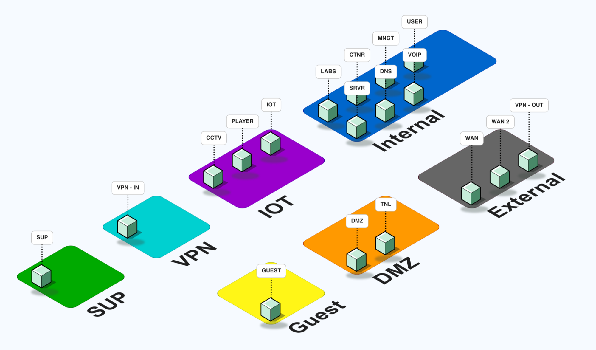

# 🔀 Réseau & segmentation VLAN

Le réseau est segmenté par catégorie d'équipement (un VLAN chacun) derrière un pare-feu zone-based (UniFi UDM Pro). Les flux entre VLANs sont régis par une matrice de zones : pas de « tout le monde se parle ».

## Plan d'adressage

> Les sous-réseaux sont dimensionnés au besoin (pas de `/24` partout) : un `/29` pour les caméras, un `/30` pour le résolveur DNS… Le plan d'adressage reste propre et le broadcast maîtrisé.

| VLAN | Nom | Sous-réseau | Usage |
|---|---|---|---|
| 1 *(natif)* | MNGT | `x.x.1.0/24` | Management (passerelle, NAS, hyperviseur) |
| 10 | USERS | `x.x.10.0/24` | Postes de travail |
| 20 | IOT | `x.x.20.0/24` | Objets connectés |
| 30 | PLAYER | `x.x.30.0/28` | Lecteurs multimédia |
| 40 | CCTV | `x.x.40.0/29` | Caméras de surveillance (VLAN dédié) |
| 50 | GUEST | `x.x.50.0/27` | Invités (isolation client) |
| 60 | LABS | `x.x.60.0/24` | Bac à sable / tests |
| 70 | VOIP | `x.x.70.0/24` | Téléphonie *(provisionné, non utilisé)* |
| 80 | SUP | `x.x.80.0/29` | Supervision |
| 90 | DNS | `x.x.90.0/30` | Résolveur DNS (AdGuard) |
| 100 | SRVR | `x.x.100.0/24` | Serveurs / VM |
| 110 | CTNR | `x.x.110.0/24` | Conteneurs / apps |
| 200 | DMZ | `x.x.200.0/24` | Zone exposée (reverse proxy) |
| 210 | TNL | `x.x.210.0/29` | Tunnel sortant (Cloudflare) |
| 220 | GAME | `x.x.220.0/29` | Serveurs de jeu (VM isolée) |
| 240 | VPN | `x.x.240.0/29` | Accès distant (WireGuard) |

*(Octets de tête masqués : plan privé RFC1918, montré pour illustrer la segmentation.)*

> Le tableau reflète le design de segmentation, pas une occupation à 100 % : quelques VLANs sont provisionnés mais pas (encore) peuplés (ex. VOIP). Je préfère documenter ce qui tourne réellement.

## Zones de confiance

Les VLANs sont regroupés en zones, et c'est entre zones que se jouent les autorisations :

*Les zones de confiance et la répartition des VLANs (la carte ne montre pas encore la zone GAME). La matrice des flux autorisés / bloqués entre zones est détaillée en [Mermaid](schemas.md).*

| Zone | VLANs | Politique |
|---|---|---|
| **Internal** | MNGT, USERS, SRVR, CTNR, DNS, LABS, VOIP | cœur de confiance : sort vers Internet, inaccessible depuis IoT / Guest / DMZ |
| **IoT** | IOT, PLAYER, CCTV | Internet uniquement, bloqué vers Internal (caméras isolées) |
| **Hotspot** | GUEST | isolé : Internet seulement, clients isolés entre eux |
| **DMZ** | DMZ, TNL | exposé depuis Internet en sens unique : ne remonte pas vers Internal (reverse proxy + tunnel sortant) |
| **SUP** | SUP | supervision : accès ciblé (scrape métriques) vers les hôtes |
| **VPN** | VPN | accès admin distant chiffré vers Internal |
| **External** | Internet | tout le reste |
| **GAME** | GAME | serveurs de jeu : isolés de toutes les autres zones |
| **Gateway** | *(interfaces passerelle)* | zone système de l'UDM, pas de VLAN utilisateur |

## Principes de segmentation (le « pourquoi »)

Un objet connecté compromis reste cantonné à son VLAN : l'IoT ne parle pas aux serveurs. Même logique pour le Wi-Fi invité, isolé du LAN et entre clients, où un visiteur ne voit que la sortie Internet. La DMZ fonctionne en sens unique : le reverse proxy est joignable depuis Internet mais ne peut pas initier de connexion vers le réseau interne. Les caméras et la téléphonie ont leurs VLANs dédiés, avec des règles propres à chaque usage, et seuls les postes admin (whitelist) atteignent l'infra.

Le deny-by-default s'applique aussi à l'intérieur même de la zone Internal : serveurs (SRVR) et conteneurs (CTNR) ne peuvent initier que les flux explicitement autorisés (allowlist), pas se parler librement. De la micro-segmentation, plus fin que le simple cloisonnement VLAN.

La démarche d'audit de ces règles est décrite dans [security.md](security.md), et le schéma de segmentation dans [schemas.md](schemas.md).
